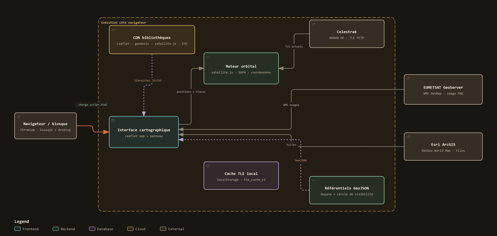

# 🛰️ Cartographie web dynamique : suivi de satellites et météo en temps réel

**Stage de 2e année de licence informatique** · 2 mois (juin – août 2026)
IRD, UMR Espace-Dev, dispositif SEAS Guyane (Surveillance de l'Environnement Amazonien assistée par Satellite), Cayenne

> Le code source de ce projet appartient à la structure d'accueil et n'est pas publié. Ce dépôt présente le contexte, l'architecture et les choix techniques.

---

## Contexte

Le dispositif SEAS Guyane fournit des images satellites aux acteurs publics pour la gestion du territoire guyanais. Ces images viennent de plusieurs constellations de satellites, et une prise de vue n'est utile que si le ciel est dégagé au moment du passage.

L'équipe avait donc besoin de **voir en un coup d'œil où sont les satellites d'observation et quelle est la couverture nuageuse au-dessus de la Guyane**, en temps réel.

## Ce que j'ai réalisé

Une **application web cartographique** qui fonctionne entièrement dans le navigateur. Je l'ai conçue et développée sous l'encadrement d'un ingénieur géomaticien.

- 🛰️ **Position en temps réel de 5 satellites d'observation** : SPOT 6, Pléiades 1A et 1B, Pléiades Neo 3 et 4. Les positions sont mises à jour chaque seconde.
-  **Traces au sol prévisionnelles** : le trajet que le satellite va survoler dans les prochaines minutes, affiché quand il s'approche de la Guyane.
-  **Couche nuageuse en temps réel** issue du satellite géostationnaire Meteosat-12 (EUMETSAT), rafraîchie toutes les 10 minutes.
-  **Référentiels géographiques** : contour de la Guyane et cercle de visibilité, au format GeoJSON.
-  **Fonctionnement en mode dégradé** : les données orbitales sont gardées en cache dans le navigateur. Si la source est indisponible, la carte continue de fonctionner.
-  **Affichage sur écran public** : déploiement sur un **Raspberry Pi** en mode kiosque, avec Chromium en plein écran, rotation automatique entre plusieurs pages et lancement au démarrage par un service `systemd`.
-  **Documentation technique** complète : notions orbitales, explication des fonctions et guide d'installation du kiosque.

## Architecture

Toute l'application tourne **côté navigateur**, sans serveur à maintenir :

| Brique | Rôle |
|---|---|
| **Leaflet** | Carte interactive, marqueurs, couches |
| **satellite.js** (modèle SGP4) | Calcul des positions actuelles et futures à partir des données orbitales |
| **Celestrak** | Données orbitales des satellites (format TLE) |
| **EUMETSAT GeoServer** | Image de la couverture nuageuse via le protocole WMS (`GetMap`) |
| **Esri ArcGIS** | Fonds de carte |
| **localStorage** | Cache local des données orbitales |

## Stack technique

`JavaScript` · `HTML` · `CSS` · `Leaflet` · `satellite.js` · `WMS (OGC)` · `GeoJSON` · `Raspberry Pi OS / Linux` · `Bash` · `systemd` · `Git`

## Défis techniques et solutions

**Passer des calculs orbitaux à une carte**
satellite.js calcule les positions dans un repère inertiel centré sur la Terre (ECI), en radians. Leaflet attend des latitudes et longitudes en degrés (WGS84). Pour la conversion, il faut calculer le temps sidéral de Greenwich (GMST) à chaque instant, passer en coordonnées géodésiques, puis convertir les radians en degrés.

**Prévoir la trace au sol**
Le même modèle SGP4 permet de calculer les positions à une date future. J'échantillonne la trajectoire à intervalles réguliers, puis je la trace sous forme de ligne géodésique. La distance entre le satellite et la Guyane est calculée avec la formule de Haversine, pour n'afficher la trace que lorsqu'elle est utile.

**Intégrer la couche météo EUMETSAT**
La méthode standard (requête `GetCapabilities`, puis plugins Leaflet) ne fonctionnait pas avec ce service. J'ai donc construit moi-même l'URL `GetMap` : couche, emprise géographique, projection et horodatage au format ISO 8601. L'horodatage tient compte du délai de publication des images, environ 30 minutes.

**Rendre l'application robuste pour un affichage permanent**
Pour un écran qui tourne 24 h/24 : cache des données orbitales en cas de panne de la source, actualisation automatique, curseur masqué, mise en veille de l'écran désactivée et rechargement quotidien de la page.

## Compétences mobilisées

- Développement web front-end (JavaScript, HTML, CSS)
- Cartographie web et standards géospatiaux (WMS, GeoJSON, systèmes de coordonnées)
- Intégration d'API et de sources de données externes
- Notions de mécanique orbitale (TLE, SGP4, repères ECI et géodésique)
- Administration Linux et déploiement sur Raspberry Pi
- Rédaction de documentation technique
- Travail en autonomie au sein d'une équipe d'ingénieurs
